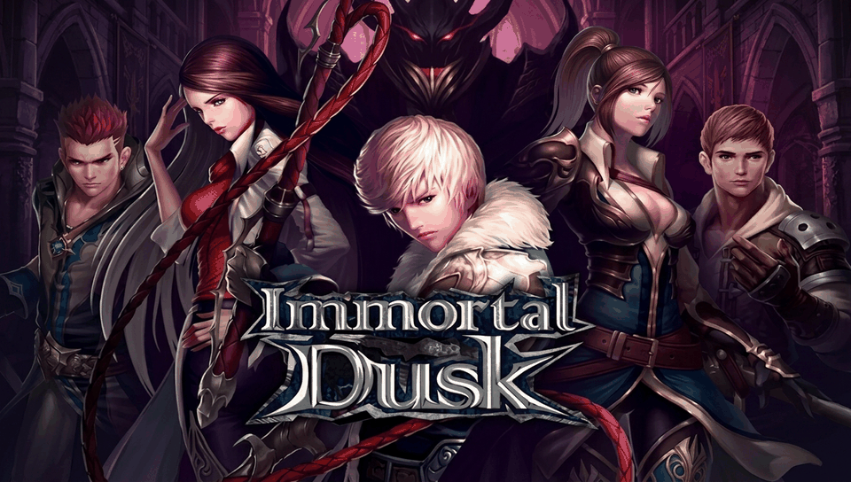

# Immortal Dusk — PS Vita Port

<p align="center">
  
</p>

<p align="center">
  <b>Native PlayStation Vita port of Gamevil's classic action RPG.</b><br/>
  Powered by dynamic ARM shared library loading (.so loader) and FalsoJNI.
</p>

<p align="center">
  
  
  
  
</p>

---

## 🌟 Port Features

- **Native 60 FPS Performance:** Internal 800x480 RGB565 software rasterizer hardware-scaled to full screen (**960x544**) with bilinear filtering via `vitaGL`.
- **Full Physical Controls & Touchscreen:** Dual mapping supporting physical action buttons, 8-way directional movement (D-Pad and Left Analog Stick), quick hotkeys for Potions/Menu, and full front touchscreen interaction.
- **Low-Latency Native Audio:** Native WAV PCM sound effects and looping MP3 background music playback powered by `sceAudio`.
- **Fully Offline Cash Shop & K-Point Emulation:** Complete local simulation of Gamevil's network protocol, eliminating infinite hangs and allowing seamless purchases of potions, resurrection stones, teleport scrolls, inventory/storage expansions, and artifact orbs without remote server connectivity.
- **High-Definition LiveArea Assets:** Icon, background, startup gate, and key art remastered and indexed to 8-bit color palettes meeting official PlayStation Vita OS specifications (error `0x8010113D` safe).

---

## 🎮 Controls

| PS Vita Button | In-Game Action |
| :--- | :--- |
| **Left Stick / D-Pad** | 8-Direction Character Movement |
| **Cross ($\times$)** | Primary Attack / Confirm |
| **Square ($\square$)** | Skill 1 |
| **Triangle ($\triangle$)** | Skill 2 |
| **Circle ($\bigcirc$)** | Skill 3 / Cancel / Back |
| **R1** | Skill 4 |
| **L1** | Quick HP Potion |
| **SELECT** | Quick MP Potion |
| **START** | In-Game Menu / Pause |
| **Front Touchscreen** | Direct touch interaction across menus, inventory, and HUD |

---

## 📦 Installation & Setup

> **Legal Notice (DMCA):** This repository does not distribute any copyrighted game assets or proprietary binaries. You must provide the assets extracted from your legally purchased copy of *Immortal Dusk v1.0.2* for Android.

### Prerequisites on your PS Vita
1. A PS Vita / PS TV running Custom Firmware (HENkaku / Enso).
2. `kubridge.skprx` kernel plugin installed in your taiHEN `config.txt`.
3. `fd_fix.skprx` (or rePatch plugin).
4. `libshacccg.suprx` extracted to `ur0:data/` (via *ShaRKBR3ED* / *CrystalPSM*).

### Asset Extraction Guide
1. Download and install `immortal_dusk.vpk` on your console via **VitaShell**.
2. Obtain your legal `Immortal Dusk_1.0.2.apk` file and rename its extension to `.zip` (or extract it with 7-Zip / WinRAR).
3. Extract the native shared library:
   - `lib/armeabi/libaist-jni.so` $\to$ `ux0:data/immortaldusk/libaist-jni.so`
4. Extract the game resource directories:
   - APK's `assets/` folder $\to$ `ux0:data/immortaldusk/assets/`
   - APK's `res/raw/` folder $\to$ `ux0:data/immortaldusk/res/raw/`
5. The final directory layout on your memory card (`ux0:`) must look like this:
   ```text
   ux0:data/immortaldusk/
   ├── libaist-jni.so
   ├── assets/
   │   ├── ani_data/
   │   ├── data/
   │   ├── font/
   │   ├── img/
   │   ├── txt/
   │   └── txte/
   ├── res/
   │   └── raw/
   │       ├── snd0.wav ... snd61.wav
   │       └── snd100.mp3 ... snd122.mp3
   └── saves/
   ```

---

## 🛠️ Building from Source

This project requires **VitaSDK** and **CMake**.

```bash
# 1. Setup VitaSDK environment variables
export VITASDK=/path/to/your/vitasdk
export PATH=$VITASDK/bin:$PATH

# 2. Clone the repository
git clone https://github.com/your-username/Inmortal-Dusk-vita.git
cd Inmortal-Dusk-vita

# 3. Build the VPK package using the automated build script
chmod +x build.sh
./build.sh
```

The output `.vpk` and `.elf` files will be placed inside the `build/` directory.

---

## 📜 Credits & Acknowledgements

- **Gamevil / KNETP** for developing the original game.
- **TheFloW** for the original `.so` loader architecture and groundwork.
- **Rinnegatamante** for `vitaGL` and invaluable contributions to the PS Vita homebrew ecosystem.
- **Volodymyr Atamanenko** for `so_util` and soloader boilerplate resources.

---

## 📄 License

The loader code is licensed under the **MIT License**. See [`LICENSE`](LICENSE) for details.
All game assets, trademarks, and original binary code belong to their respective copyright holders.
