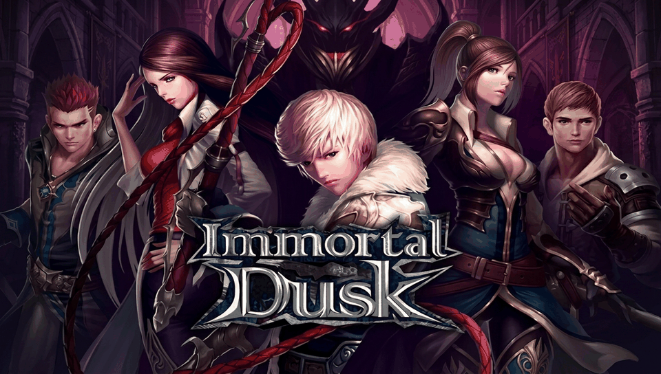

<h1 align="center">
  <br>
  Immortal Dusk · PS Vita Port
</h1>

<p align="center">
  <b>Native port of Immortal Dusk (Gamevil) for PlayStation Vita and PlayStation TV.</b>
</p>

<p align="center">
  
  
  
  
  
  
</p>

<p align="center">
  <a href="#-description">Description</a> •
  <a href="#-features">Features</a> •
  <a href="#-controls">Controls</a> •
  <a href="#-installation">Installation</a> •
  <a href="#-known-issues">Known Issues</a> •
  <a href="#-building-from-source">Build</a> •
  <a href="#-credits">Credits</a>
</p>

---

## 📖 Description

**Immortal Dusk** is Gamevil's classic action RPG, originally released for Android (`Immortal Dusk_1.0.2.apk`).

This port runs the original native library (`libaist-jni.so`, armeabi) on the PS Vita through a dynamic ARM shared-library
loader (*so_util*), with a *FalsoJNI* layer that answers the game's JNI calls. The game draws into an internal 800x480 RGB565
software framebuffer, which is shown full screen (960x544) as a texture through [vitaGL](https://github.com/Rinnegatamante/vitaGL)
with bilinear filtering. Audio is mixed natively on `sceAudioOut`. The port also emulates the offline parts of the
game's network protocol (the cash shop and K-Points).

---

## 🎮 Status & Playability

**Status: Boots (v1.0)**. A device log (`logs/game_003.log`, opened from `ux0:data/immortaldusk/logs/`) shows the loader
running the game's JNI initialization on the console. That log has no frame output and ends during boot, so gameplay on
hardware is not confirmed yet.

- [x] **Loader & JNI bootstrap**: `libaist-jni.so` loads and its JNI calls run on the console (`logs/game_003.log`). *Verified on console.*
- [ ] **Rendering and gameplay**: no frames are recorded in the logs yet; the 60 FPS and the menus have not been measured or confirmed.
- [ ] **Options menu (Start + Select), button remapping and live language switch**: implemented; the notes list them as pending a console test.
- [ ] **Spanish / Portuguese text and accents**: implemented; pending console checks (accents, `¿ ¡`, dialog paging, cash-shop popups).
- [ ] **Audio**: native WAV and MP3 playback is implemented; not yet confirmed on the console.
- [ ] **Offline cash shop**: implemented; not yet confirmed on the console.

### Key Points

- **Native 60 FPS target**: internal 800x480 RGB565 software rasterizer, hardware-scaled to full screen (**960x544**) with
  bilinear filtering via `vitaGL`. *The 60 FPS figure is the design target; it has not been measured yet.*
- **Full physical controls & touchscreen**: dual mapping with the physical action buttons, 8-way directional movement
  (D-Pad and Left Analog Stick), quick hotkeys for potions and the menu, and full front touchscreen interaction.
- **Options menu & translations**: START + SELECT opens a pause menu with button remapping, frame-rate mode and a live
  text language switch (English / Spanish / Portuguese).
- **Low-latency native audio**: native WAV PCM sound effects and looping MP3 background music, played through `sceAudio`
  (the port notes describe a 12-voice mixer with `minimp3`).
- **Fully offline cash shop & K-Point emulation**: local simulation of Gamevil's network protocol, so purchases of potions,
  resurrection stones, teleport scrolls, inventory / storage expansions and artifact orbs complete without a server.
- **High-definition LiveArea assets**: icon, background, startup gate and key art indexed to 8-bit palettes that meet the
  PS Vita OS specifications (error `0x8010113D` safe).

### Changelog

**v1.0** (first official release, `RELEASE_NOTES.md`, `CMakeLists.txt` `VITA_VERSION` 01.00)
- Native 60 FPS design target with the 800x480 RGB565 software rasterizer scaled to 960x544 through vitaGL.
- Dual physical and touch input: 8-direction movement, face buttons and triggers for combat and item shortcuts, full front-touch support.
- Multi-voice audio engine on `sceAudioOut`: WAV PCM sound effects and memory-streamed MP3 background music (`minimp3`).
- Offline cash shop and K-Point emulation for potions, resurrection stones, teleport scrolls and storage / bag expansions.
- LiveArea icon, startup gate and background remastered with 8-bit indexed palettes.

---

## ✨ Features

| Feature | Status | Notes |
| :--- | :---: | :--- |
| Boots to gameplay | 🧪 | Loader and JNI bootstrap run on the console (`logs/game_003.log`); no frames logged yet |
| Graphics / renderer | 🧪 | 800x480 RGB565 software framebuffer scaled to 960x544 through vitaGL. The 60 FPS target is not measured yet |
| Audio & music | 🧪 | Native WAV PCM effects and looping MP3 music (`minimp3`) on `sceAudio`; not confirmed on the console |
| Video / cutscenes | 🧪 | Not documented in the repository <!-- TODO: confirm --> |
| Physical buttons | 🧪 | 8-way movement and face-button actions; not confirmed on the console |
| Analog sticks / camera | 🧪 | Left stick and D-Pad move the character (8 directions); no camera control is documented |
| Touch screen | 🧪 | Front touch for menus, inventory and HUD; pending console test |
| Button remapping / port menu | 🧪 | START + SELECT options menu with remapping, frame-rate mode and language. Implemented; pending console test |
| Save data | 🧪 | Saves in `ux0:data/immortaldusk/saves/`; not confirmed on the console |
| Native trophies | ➖ | No trophy data in the repository |
| Languages | 🧪 | English, Spanish and Portuguese text (live switch); pending console test |
| Performance | 🧪 | Target 60 FPS (`AUTO` / `ORIGINAL` / `60 FPS` modes); not measured |
| Online / IAP / ads | 🧪 | Offline cash shop and K-Point emulation replace Gamevil's servers; pending console test |
| PS TV | 🧪 | Not tested |

Legend: `✅ Working (verified on console) · 🧪 Implemented, not yet verified on console · 🟡 Partial · ❌ Not working · ➖ Not applicable · ❔ Not documented yet`

---

## 🎯 Controls

| PS Vita Button | In-Game Action |
| :--- | :--- |
| **Left Stick / D-Pad** | 8-direction character movement |
| **Cross (×)** | Primary attack / confirm |
| **Square (□)** | Skill 1 |
| **Triangle (△)** | Skill 2 |
| **Circle (○)** | Skill 3 / cancel / back |
| **R1** | Skill 4 |
| **L1** | Quick HP potion |
| **SELECT** | Quick MP potion |
| **START** | In-game menu / pause |
| **Front touchscreen** | Direct touch interaction across menus, inventory and HUD |
| **START + SELECT** | Options menu (game pauses) |

### Options menu (START + SELECT)

- **Button remapping**: every action (Attack, Skills 1–4, HP/MP potion, game menu) can be bound to any face button, L1, R1,
  SELECT or START. `X` replaces the binding, `[]` adds another button, `/\` clears it.
- **Frame rate**: `AUTO` (default, previous behaviour), `ORIGINAL` (honours the in-game *Game Speed* option exactly like
  Android) or `60 FPS` (fixed).
- **Text language**: `ENGLISH` / `ESPANOL` / `PORTUGUES`, switched live (an already open window refreshes when the game
  redraws it).
- `O` saves and closes. Everything is stored in `ux0:data/immortaldusk/controls.txt`, which can also be edited by hand.

### Text language

Full Spanish and Portuguese translations are available as a separate pack (`immortaldusk_vita_traduccion_ES_PT.zip`):
menus, items, skills, quests, help, tips, NPC chatter, the whole story and quest dialogue, and the cash-shop popups
(number slots kept in place). Copy the pack's `immortaldusk/` folder into `ux0:data/` and pick the language in the options
menu. The English files are never modified, and anything missing falls back to English. Proper nouns (characters, places,
monsters and most item names) stay as in the original.

Accented letters (á é í ó ú à â ê ô ã õ ü ñ ç, their uppercase forms, ¿ ¡) are drawn by the loader in the game's own font
style. Each one is built from the game's base letter glyph plus an accent stroke of the same thickness, and ¿ ¡ are the
font's own ? and ! turned upside down. If the loader does not find the expected `libaist-jni.so` code, it shows the plain
letters instead.

To rebuild the pack from the templates in `immortaldusk_translation/<lang>/`: `python3 scripts/txt_lang.py zip`
(`test` checks that an identity repack is byte-identical).

---

## 📋 Prerequisites

1. A PS Vita / PS TV running Custom Firmware (HENkaku / Enso).
2. [**kubridge.skprx**](https://github.com/TheOfficialFloW/kubridge/releases) kernel plugin installed in your taiHEN `config.txt`.
3. [**fd_fix.skprx**](https://github.com/TheOfficialFloW/FdFix/releases) (or rePatch plugin).
4. `libshacccg.suprx` extracted to `ur0:data/` (via *ShaRKBR33D* or *CrystalPSM*).
5. Your own legal copy of **Immortal Dusk v1.0.2** for Android (`.apk`).

---

## 📦 Installation

> **Legal Notice (DMCA):** This repository does not distribute any copyrighted game assets or proprietary binaries. You must
> provide the assets extracted from your legally purchased copy of *Immortal Dusk v1.0.2* for Android.

### Asset Extraction Guide

1. Download and install `immortal_dusk.vpk` on your console via **VitaShell**.
2. Obtain your legal `Immortal Dusk_1.0.2.apk` file and rename its extension to `.zip` (or extract it with 7-Zip / WinRAR).
3. Extract the native shared library:
   - `lib/armeabi/libaist-jni.so` → `ux0:data/immortaldusk/libaist-jni.so`
4. Extract the game resource directories:
   - APK's `assets/` folder → `ux0:data/immortaldusk/assets/`
   - APK's `res/raw/` folder → `ux0:data/immortaldusk/res/raw/`
5. The final directory layout on your memory card (`ux0:`) must look like this:
   ```text
   ux0:data/immortaldusk/
   ├── libaist-jni.so
   ├── assets/
   │   ├── ani_data/
   │   ├── data/
   │   ├── font/
   │   ├── img/
   │   ├── txt/
   │   └── txte/
   ├── res/
   │   └── raw/
   │       ├── snd0.wav ... snd61.wav
   │       └── snd100.mp3 ... snd122.mp3
   ├── logs/             <- created by the game (game_NNN.log)
   └── saves/            <- created by the game
   ```
6. Launch the game from your LiveArea.

---

## 🐛 Known Issues

- **Not yet confirmed on the console**: rendering and gameplay, the 60 FPS target, the options menu, button remapping,
  the live language switch, the accents and dialog paging in ES/PT, the cash-shop popups, and audio.
- **Boot log ends early**: `logs/game_003.log` stops during the JNI initialization, with no frame output.
- **Missing-method messages**: the boot log reports `GetMethodID ... "netConn"` as not found (logged as an error, cause not yet analysed).
- **Offline by design**: online services are replaced by the local cash-shop and K-Point emulation.
- **Logs and crash dumps**: the game log is written to `ux0:data/immortaldusk/logs/game.log`. Crash dumps are written by
  the system to `ux0:data/`. Attach both when you report a problem.

---

## 🔨 Building from Source

This project requires **VitaSDK** and **CMake**.

```bash
# 1. Setup VitaSDK environment variables
export VITASDK=/path/to/your/vitasdk
export PATH=$VITASDK/bin:$PATH

# 2. Clone the repository
git clone https://github.com/MetalSyntax/Inmortal-Dusk-vita.git
cd Inmortal-Dusk-vita

# 3. Build the VPK package using the automated build script
chmod +x build.sh
./build.sh
```

The output `.vpk` and `.elf` files will be placed inside the `build/` directory.

---

## 📁 Project Structure

- `source/`: loader, JNI bridge (`java.c`), `main.c`, `patch.c`, pause/options menu (`menu.c`, `menu.h`), accent font (`accent_font.c`), debug font (`utils/debugScreenFont.c`).
- `lib/`: `vitagl`, `vitashark` and the other support libraries.
- `patches/`: `vitagl-disable-system-app-mode.patch`.
- `scripts/`: `build_vitagl.sh` and `txt_lang.py` (translation pack builder).
- `immortaldusk_translation/`: ES and PT translation templates (`es/`, `pt/`).
- `decompiled/`: JADX output of the APK and the decompiled `libaist-jni` analysis.
- `extras/`: LiveArea assets and helper scripts.
- `logs/`: device logs from development.
- `PORTING_PLAN.md`: porting plan. `port_progress.md`: phase-by-phase progress log.

---

## 📜 Disclaimer

**Immortal Dusk** and **Gamevil** are the property of their respective owners. This project is unofficial and is not produced,
endorsed or sanctioned by Gamevil.

This software does NOT contain original game code, binaries or assets. The authors do not promote or condone piracy in any
way. To play, you must provide your own legally obtained copy of the game (`.apk`).

---

## ☕ Support My Work

This project is **free** and will stay free. If you enjoy it, a tip from **$1** helps me keep porting games to the PS Vita:

<p align="center">
  <a href="https://ko-fi.com/metalsyntax"></a>
</p>

- **Ko-fi:** [ko-fi.com/metalsyntax](https://ko-fi.com/metalsyntax)
- **PayPal:** [paypal.me/MetalSyntax](https://paypal.me/MetalSyntax)
- **Bitcoin (BTC):** `133HdCsaWxdjTfmwpgGVykByhNBV338uRc`

**Ko-fi supporters get:**
- **Early access** to new ports before their public release (test builds of upcoming projects).
- **Data preparation scripts and step-by-step guides** to set up your own game files for each new port.
- A say in which games I port next.

> Game files are never distributed. You always need your own legally obtained copy of the game.

---

## 👥 Credits

- **Gamevil / KNETP**: original developers of *Immortal Dusk*.
- **TheFloW**: for the original `.so` loader architecture and `kubridge`.
- **Rinnegatamante**: for [vitaGL](https://github.com/Rinnegatamante/vitaGL) and contributions to the PS Vita homebrew scene.
- **Volodymyr Atamanenko (v-atamanenko)**: for `so_util` and soloader boilerplate resources.
- **MetalSyntax**: this port.

---

## 📄 License

The loader code is licensed under the **MIT License** (Copyright (C) 2021 Andy Nguyen, Copyright (C) 2021-2022 Rinnegatamante,
Copyright (C) 2022-2024 Volodymyr Atamanenko). See [`LICENSE`](LICENSE) for the full text.
All game assets, trademarks and original binary code belong to their respective copyright holders.
